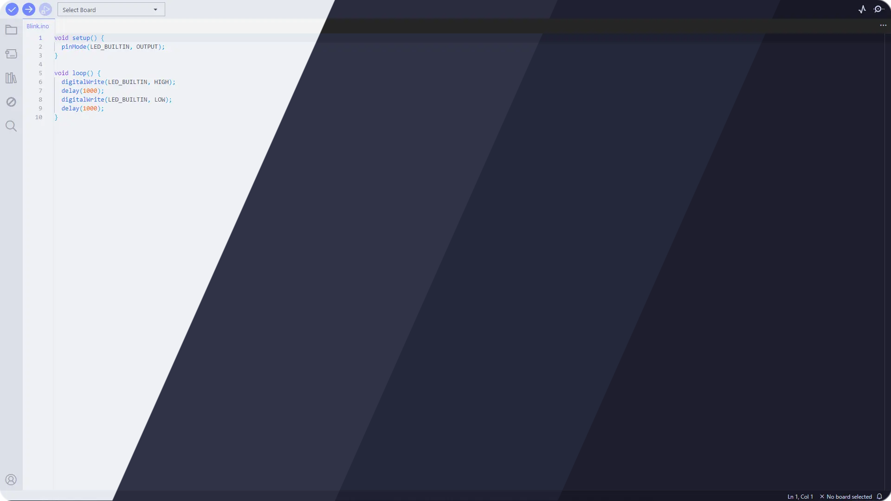
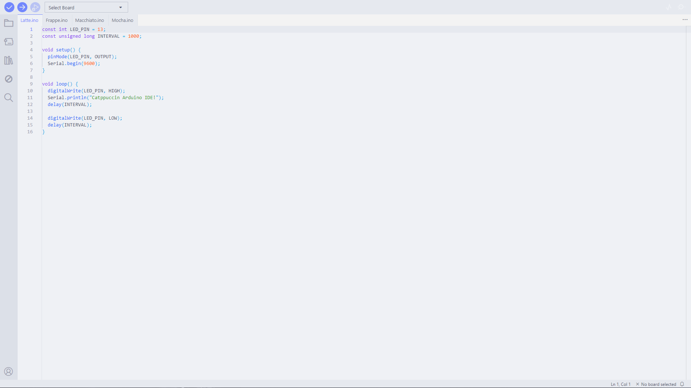
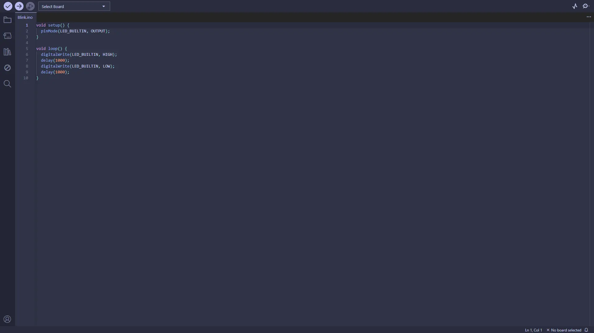
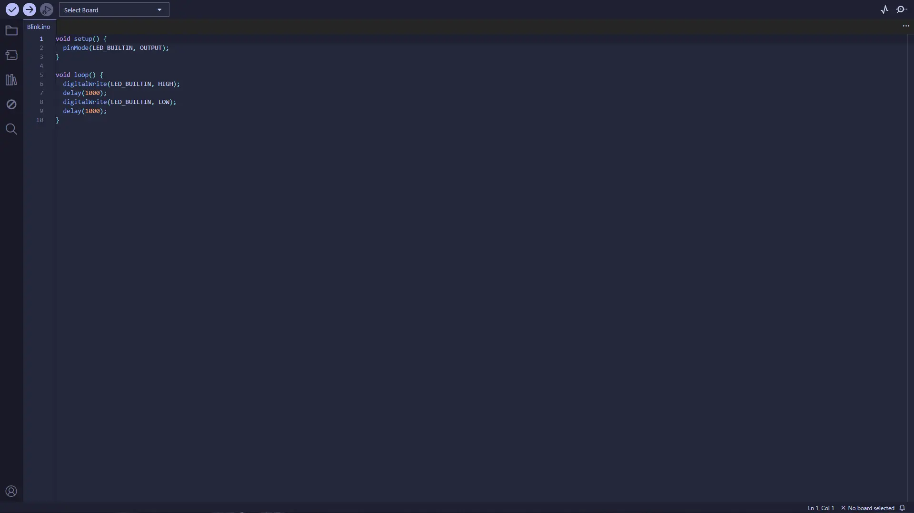
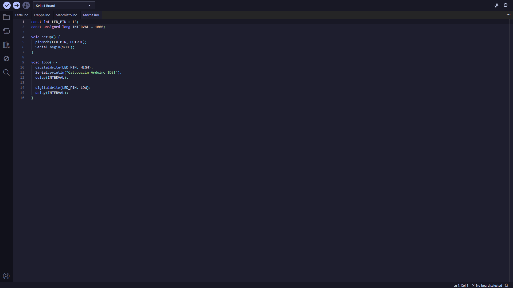

<h3 align="center">
	<br/>
	
	Catppuccin for <a href="https://github.com/arduino/arduino-ide">Arduino IDE</a>
	
</h3>

<p align="center">
	<a href="https://github.com/catppuccin/template/stargazers"></a>
	<a href="https://github.com/catppuccin/template/issues"></a>
	<a href="https://github.com/catppuccin/template/contributors"></a>
</p>



## Previews

<details>
<summary>🌻 Latte</summary>

</details>
<details>
<summary>🪴 Frappé</summary>

</details>
<details>
<summary>🌺 Macchiato</summary>

</details>
<details>
<summary>🌿 Mocha</summary>

</details>

## Usage

1. Download the latest release.
2. Copy the downloaded .vsix file.
3. Open File Explorer.
4. Paste the file into the Arduino IDE plugins folder: (Create the folder if needed)
    ```text
    C:\Users\%USERPROFILE%\.arduinoIDE\plugins\
    ```
5. Open Arduino IDE and press Ctrl+Comma
6. Click on theme and select your preferred flavor
## 💝 Thanks to

- [Samx123-code](https://github.com/catppuccin)

&nbsp;

<p align="center">
  
</p>

<p align="center">
	Copyright &copy; 2021-present <a href="https://github.com/catppuccin" target="_blank">Catppuccin Org</a>
</p>

<p align="center">
	<a href="https://github.com/catppuccin/catppuccin/blob/main/LICENSE"></a>
</p>
